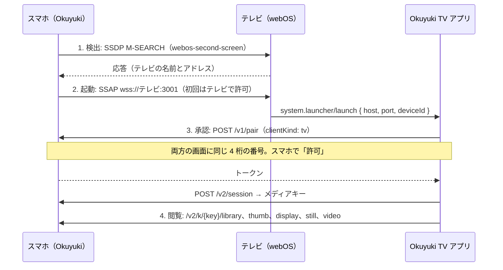
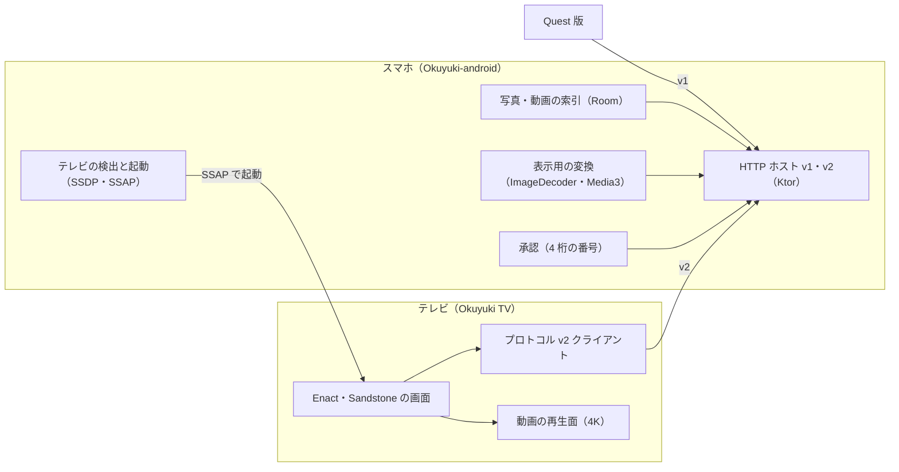

# Okuyuki TV（LG webOS）仕様書 v0.1

2026-10-12 · Ryuta さんと Claude で作成。共有用のドキュメント版と同じ内容です。

## 1. 目的と前提

Okuyuki TV は、Galaxy に入っている写真と動画を、同じ Wi-Fi にある LG webOS テレビで、テレビが出せる最高の画質で見るためのアプリです。写真はスマホに置いたままにし、テレビは表示に必要なデータだけを一時的に受け取ります。これは Quest 版と同じ考え方です。

- **スマホ側**: 既存の Okuyuki-android を拡張して、テレビ向けのホストにもします。
- **テレビ側**: 新しい webOS Web アプリ（このリポジトリ）を作ります。
- **Quest 版との関係**: ペアリングの承認方式とプロトコルを共通にします。v1 の Quest 版はそのまま動き続けます。

設計を決める 4 つのプラットフォーム制約:

1. webOS の Web アプリは、4K テレビでも UI を最大 1920×1080 で描画します。3840×2160 で出せるのは動画の再生面だけです（[LG: Supported App Resolution](https://webostv.developer.lge.com/develop/specifications/app-resolution)）。
2. LG テレビは 3D 表示に対応していません。3D 写真は片目の画像を 2D で表示します。
3. テレビのブラウザは HEIC を表示できません。スマホ側で表示用の形式に変換します。
4. Web アプリは mDNS で機器を探せません。そのため、スマホがテレビを探しに行きます。

**対象機器**: 最初の対象は Ryuta さんの LG OLED evo C5（2025 年モデル、webOS 25、Web エンジンは Chromium 120）です。4K パネルで HDR10・HLG・Dolby Vision に対応しています。対応範囲は webOS 22（2022 年、Chromium 87）以降とし、実機での確認は C5 で行います。出典: [LG: Web API and Web Engine](https://webostv.developer.lge.com/develop/specifications/web-api-and-web-engine)。

## 2. 範囲

最初の版（アルファ）は「スマホからテレビを起動し、写真と動画を最高画質で見る」ところまでです。

| 区分 | 内容 |
| --- | --- |
| 最初の版に含む | スマホからのテレビ検出とアプリ起動、手動のアドレス入力、スマホでの承認、ライブラリの一覧（すべて／写真／動画／3D）、写真の標準表示と最高画質表示、動画の元ファイル再生、リモコン操作 |
| 含まない | テレビへの写真の保存、クラウド経由の接続、3D の立体表示、写真の編集や削除、LG 以外のテレビ |
| 後続版 | スライドショーと BGM、アルバムや日付での絞り込み、TLS による暗号化、LG Content Store での公開、8K テレビへの最適化 |

## 3. 利用の流れ

テレビのリモコンで文字を打たずに、スマホの操作だけで見始められることを最優先にします。

**初回接続**

1. スマホの Okuyuki で「テレビで見る」を押す。
2. 同じ Wi-Fi の LG テレビが一覧に出るので選ぶ。
3. テレビに「この機器からの接続を許可しますか」が出るので、リモコンで許可する（初回のみ）。
4. テレビで Okuyuki TV が自動で起動し、両方の画面に同じ 4 桁の番号が出る。
5. スマホで「許可」を押すと、テレビにライブラリが表示される。

**2 回目以降**: スマホで「テレビで見る」を押すだけで、保存済みの許可を使ってそのまま開きます。テレビのアプリ一覧から直接起動した場合は、前回のスマホに接続を試みます。

**閲覧**: グリッドで選んで決定ボタン。写真は全画面で表示し、左右キーで前後に移ります。動画は全画面で再生し、再生・一時停止・早送りに対応します。スマホで写真を選んで「テレビで表示」もできます。

**終了**: テレビのアプリを閉じるか、スマホで「接続をオフ」を押すと、テレビのメモリ上の写真は破棄されます。

## 4. 画質仕様

動画は元ファイルをそのままテレビのハードウェアで再生し、写真は「最高画質」を選ぶと動画の再生面を使って 4K で表示します。

| 種類 | 表示方法 | 解像度 | HDR | スマホ側の処理 |
| --- | --- | --- | --- | --- |
| 動画（4K まで） | 元ファイルを `<video>` で再生（Range 対応） | 元のまま | HDR10、HLG。HDR10+ は HDR10 として表示 | なし。テレビが再生できない形式（mp4・webm 以外や Dolby Vision など）と 60 Mbps を超えるものだけ変換 |
| 8K 動画 | 4K に変換して再生（C5 は 4K モデル） | 3840×2160 | 元に合わせる | Media3 Transformer で 4K の HEVC に変換。HDR はテレビが表示できれば保つ |
| 写真（標準） | `` で表示 | 1920×1080 | なし | ImageDecoder で 1920×1080 に収まる高品質 JPEG に変換 |
| 写真（最高画質） | 静止画動画として再生面に表示し、UI を上に重ねる | 3840×2160 | Ultra HDR 写真は HLG で表示（スマホが作れないときは SDR） | Media3 Transformer で 4K の静止画動画に変換。HEVC（再生できないテレビには H.264）で、HDR 写真は HLG の 10bit |
| 3D 写真 | HEIC の主画像（片目）を上のどちらかで表示 | 上に同じ | 上に同じ | 主画像がどちらの目かは実機で確認 |

コーデックと上限は [LG: webOS TV 25 の動画形式](https://webostv.developer.lge.com/develop/specifications/video-audio-250) によります。

規定の動作:

- 写真を開くと、まず標準画質をすぐに出し、最高画質の準備ができたら切り替えます。設定で「常に標準」にもできます。
- 再生できる形式は起動時に `canPlayType` で調べ、スマホに伝えます。スマホはそれを見て変換が必要かを決めます。
- 変換した結果はスマホのアプリ内の一時領域に置き、上限 2GB で古いものから消します。
- 前後 1 枚ずつを先に準備して、左右キーでの切り替えを速くします。

「最高画質」と HDR 写真の表示品質、各機種での対応形式は、まだ実機で確認していません。最初の試作で確かめます（11 章、[STILL4K.md](STILL4K.md)）。

## 5. 接続とペアリング

スマホがテレビを見つけてアプリを起動し、接続の承認は Quest 版と同じくスマホで行います。

テレビのリモコンで操作するのは、初回の「この機器を許可」だけです。接続の承認はいつもスマホ側で行います。

1. **検出**: スマホが SSDP（UDP 1900 のマルチキャスト）で `urn:lge-com:service:webos-second-screen:1` を探し、応答したテレビを一覧にします。見つからないときはテレビの IP アドレスを入力できます。
2. **起動**: スマホがテレビの SSAP（`wss://<テレビ>:3001`）に接続し、`ssap://system.launcher/launch` で `com.okuyuki.tv` を起動します。パラメータは `{ host, port, deviceId }` です。初回だけテレビに接続許可の確認が出て、許可するとテレビが発行する client-key をスマホに保存します。
3. **承認**: テレビアプリが `POST /v1/pair` を送り、両方の画面に同じ 4 桁の番号を出します。スマホで「許可」を押すとトークンが発行されます。
4. **再接続**: テレビアプリはトークンと最後に使ったスマホのアドレスを保存します。テレビのホームから直接起動したときは、まずそのアドレスに接続します。
5. **手動入力**: どれも使えないときは、スマホに表示された「IP:ポート」をテレビの数字入力画面で入れます。

SSAP は LG が公開仕様としては提供していないものの、Home Assistant などで広く使われている接続方式です。使えなくなっても「テレビ側から起動して再接続」と「手動入力」で動くようにします。

## 6. プロトコル v2

v1 はそのまま残し、テレビ向けの機能を `/v2` に足します。Quest 版は v1 のまま動きます。

ブラウザの ``、`<video>`、WebSocket は Authorization ヘッダーを付けられません。そこで、承認済みのトークンでセッションを開き、発行されたメディアキーを URL に含める方式にします。キーは 128bit の乱数で、12 時間で失効し、スマホが接続をオフにするか許可を取り消すとすぐに無効になります。

| メソッド | パス | 内容 | 認証 |
| --- | --- | --- | --- |
| GET | `/v1/hello` | 既存。`protocolVersions: [1, 2]` を追加 | なし |
| POST | `/v1/pair` | 既存。`clientKind: "quest" \| "tv"` を追加 | なし |
| POST | `/v2/session` | メディアキーを発行。`{ key, expiresAt }` | Bearer |
| POST | `/v2/k/{key}/capabilities` | テレビの画面と再生できる形式を伝える | キー |
| GET | `/v2/k/{key}/library?filter=&cursor=` | `filter` は all・photo・video・stereo。`(takenAt, id)` のキーセットで最大 60 件 | キー |
| GET | `/v2/k/{key}/items/{id}` | 1 件の情報（`Item`） | キー |
| GET | `/v2/k/{key}/items/{id}/thumb` | サムネイル JPEG（長辺 480px） | キー |
| GET | `/v2/k/{key}/items/{id}/display` | 標準画質 JPEG（1920×1080 に収める） | キー |
| POST | `/v2/k/{key}/items/{id}/prepare?target=still\|video` | 最高画質の静止画動画、または再生用の動画を準備。`{ state, url, width, height, hdr, mime, codecs, progress }` | キー |
| GET | `/v2/k/{key}/items/{id}/still` | 4K 静止画動画（Range 対応） | キー |
| GET | `/v2/k/{key}/items/{id}/video` | 動画。元ファイルか 4K 変換版（Range 対応） | キー |
| WS | `/v2/k/{key}/events` | `library_changed`、`prepared`、`show`、`viewing`、`heartbeat`、`session_closed` | キー |

**データ型**: `Item` は `id`、`kind`（photo・video）、`name`、`takenAt`、`width`、`height`、`sizeBytes`、`mime`、`durationMs`、`stereo`、`hdr`（none・ultrahdr・hdr10・hlg・hdr10plus）を持ちます。

**CORS**: テレビのアプリは `file://` 起点なので、ホストは全応答に `Access-Control-Allow-Origin: *` を付けます。事前確認には `Access-Control-Allow-Headers: Authorization, Content-Type, Range` と `Access-Control-Allow-Private-Network: true` を返します。

**共通定義**: 型の定義はこれまでどおり `core/protocol` に置き、JSON の見本ファイルを 3 リポジトリで共有して、Kotlin と TypeScript の両方のテストで同じ形を確かめます。

## 7. テレビアプリの構成と画面・リモコン操作

テレビアプリは LG 公式の Enact（React 系）と Sandstone（テレビ向け部品集）で作り、画面は 4 つです。リモコンの十字キーとマジックリモコンのポインターの両方で操作できます。

テレビアプリの画面はすべてスマホの HTTP ホストだけを相手にします。Quest 版は同じホストの v1 を今までどおり使います。

| 画面 | 内容 |
| --- | --- |
| 接続 | 接続の状態、4 桁の番号、アドレスの手動入力 |
| ライブラリ | 「すべて・写真・動画・3D」のタブと、日付順のサムネイル一覧（表示中の分だけ読み込む） |
| 写真 | 全画面表示。画質の表示（「標準」「4K」「4K HDR」）と日時を重ねて出す |
| 動画 | 全画面再生。シークバーと再生時間 |

| キー | ライブラリ | 写真 | 動画 |
| --- | --- | --- | --- |
| 十字キー | フォーカス移動 | 左右で前後の写真 | 左右で 10 秒戻る・進む |
| 決定 | 開く | 情報の表示・非表示 | 再生・一時停止 |
| 戻る | アプリを閉じるか確認 | ライブラリへ | ライブラリへ |
| 再生・一時停止 | なし | なし | 再生・一時停止 |

実装上の決まり:

- 動画の再生面はグラフィック面の後ろにあるため、写真・動画画面では `html`、`body` と親要素の背景を透明にします。
- 写真のバイトは `` と `<video>` の読み込みだけで扱い、localStorage、IndexedDB、Cache API には入れません。
- パラメータ付きの起動は `webOSLaunch` と `webOSRelaunch` イベントで受け取ります。
- 開発時はスマホの代わりに動く模擬ホスト（Node.js）を使い、CI では Playwright で画面を確かめます。

## 8. スマホ側の追加機能

Okuyuki-android に、テレビの起動、写真と動画の索引、表示用の変換、プロトコル v2 を足します。Quest との接続はそのまま使えます。

1. **テレビで見る**: SSDP でテレビを探し、SSAP でアプリを起動します。テレビの証明書は自己署名なので、初回に見た証明書を記録し、次回から一致を確かめます。client-key は Android Keystore で暗号化して保存します。
2. **索引の拡張**: これまでの 3D 写真に加えて、すべての写真と動画を索引します。Room のスキーマを v2 に移行し、種類、MIME、長さ、HDR の列を足します。
3. **変換**: 標準画質は ImageDecoder で JPEG にします。最高画質の静止画動画と 8K 動画の 4K 化は Media3 Transformer で行います。変換結果はアプリ内の一時領域に 2GB まで置き、古いものから消します。
4. **プロトコル v2**: 6 章のエンドポイント、メディアキー、CORS を実装します。
5. **テレビで表示**: スマホのライブラリから 1 枚を選んでテレビに出せます（`show` イベント）。
6. **ペアリングの修正**: 評価で見つけた「同じ clientId の要求に相乗りできる」問題を、テレビ対応より前に直します。

## 9. セキュリティとプライバシー

写真はテレビに保存しないことと、接続を許可できるのはスマホだけであることを、Quest 版と同じく守ります。

- **写真を残さない**: テレビアプリは写真と動画をメモリ上でだけ扱います。保存するのはトークン、スマホの名前とアドレス、設定だけです。
- **承認**: スマホでの承認と 4 桁の番号の照合は Quest 版と共通です。評価で見つけた相乗りの問題は、保留中の要求を `requestId` でしか引けないようにして直します。
- **トークンの保存**: webOS には Keystore に当たる仕組みがないため、アプリごとに分離された localStorage に保存します。スマホ側でいつでも許可を取り消せます。
- **メディアキー**: URL に含めるキーは 128bit の乱数で、12 時間、またはスマホが接続をオフにするまで有効です。
- **SSAP**: テレビにはアプリの起動に必要な権限だけを求めます。テレビの証明書は初回に記録し、変わっていたら接続しません。
- **通信の暗号化**: アルファは Quest 版と同じく、信頼できる家庭内 Wi-Fi での HTTP です。webOS のアプリに自己署名証明書を信頼させる方法は限られるため、TLS の方式は後続版で決めます。

## 10. 非機能要件と受け入れ基準

LG C5 と Galaxy S25 Ultra の実機で次の基準を満たしたらアルファ完成とします。時間の数値は目標値で、試作 1 の結果で見直します。

| 項目 | 基準 | 確認方法 |
| --- | --- | --- |
| 4K 表示 | 最高画質で 1 画素幅の縞模様が潰れずに見え、標準画質では潰れる | 検証アプリのテストチャートを目視・撮影 |
| HDR 写真 | Ultra HDR 写真でテレビが HDR 表示に切り替わる | テレビの画質情報表示 |
| 写真の表示 | 標準画質が 1 秒以内、最高画質が 3 秒以内に出る | アプリ内の計測ログ |
| 左右キーでの切り替え | 先読み済みなら 0.5 秒以内、黒い画面を挟まない | 計測ログと目視 |
| 動画 | 4K60 HEVC 10bit HDR の元ファイルがコマ落ちなく再生され、シークが 2 秒以内 | 目視と計測ログ |
| 接続 | 2 回目以降はスマホのボタンから 10 秒以内にテレビでライブラリが出る | ストップウォッチ |
| 写真が残らない | 終了後、アプリの保存領域に写真データがない | Web Inspector |
| 安定性 | 1 時間の連続使用で強制終了しない | 実機での試用 |

ネットワークは、テレビを有線 LAN または 5GHz 帯の Wi-Fi につなぐことを推奨します。C5 の HEVC 4K60 の上限は 60 Mbps です。

## 11. 進め方とリスク、未決事項

最初に試作 1 で「4K 静止画動画」が C5 で期待どおりに動くかを確かめ、その結果でアルファの細部を確定します。アルファのコードは試作と並行して作ります。

1. **リポジトリ作成**: `lingmulongtai/Okuyuki-webos`（公開）。
2. **試作 1：4K 静止画の検証**（[STILL4K.md](STILL4K.md)）: テストチャートを ``（1080p）と 4K HEVC 静止画動画で比べます。HDR10・HLG の静止画、動画の作り方の違い、`<video>` 1 つと 2 つでの切り替え速度、UI の重ね表示、再生できる形式を記録します。素材はアプリに同梱し、自分の写真でも試せるように PC 用の変換スクリプトと簡易サーバーも付けます。
   - 合格条件: 1 画素の縞が 4K で見える、切り替えが 3 秒以内、UI が動画の上に出る。
3. **試作 2：SSAP 起動の検証**: スマホからアプリを起動し、パラメータが届くかを確かめます。
4. **アルファ**: プロトコル v2、スマホ側の索引と変換、テレビアプリの 4 画面。CI で単体テスト、Playwright の画面テスト、IPK の作成を行います。
5. **後続版**: スライドショー、TLS、LG Content Store での公開。

| リスク | 起きたときの影響 | 対策 |
| --- | --- | --- |
| 静止画動画の切り替えで黒い画面が挟まる、または遅い | 最高画質の体験が悪い | `<video>` 2 つを交互に使う。だめなら「標準で表示し、決定キーで 4K に切り替え」にする |
| 動画の上に UI が重ならない | 情報表示が出せない | 試作 1 で確認。だめなら UI を出す間だけ標準画質に戻す |
| SSAP が使えない、または設定でオフ | スマホから起動できない | テレビ側から起動して再接続、手動入力 |
| HDR 写真の明るさや色がスマホと違う | 見え方の差 | 変換の基準輝度を調整できるようにする |
| 開発者モードの期限切れ | 試作アプリが消える | 延長手順を [STILL4K.md](STILL4K.md) に書く。最終的にはストアで公開 |
| C5 の上限を超える動画 | 再生できない | スマホで 4K・60 Mbps 以下に変換 |

**未決事項**

- テレビの正確な型番。「C5M」という表記が見つからないので、設定の「このテレビについて」の型番を確認したいです。
- LG Developer アカウントの有無（開発者モードに必要）。
- 個人利用のみか、LG Content Store での公開も目指すか。

**出典**: [LG: Supported App Resolution](https://webostv.developer.lge.com/develop/specifications/app-resolution)、[LG: Web API and Web Engine](https://webostv.developer.lge.com/develop/specifications/web-api-and-web-engine)、[LG: webOS TV 25 の動画形式](https://webostv.developer.lge.com/develop/specifications/video-audio-250)、[LG: Developer Mode App](https://webostv.developer.lge.com/develop/getting-started/developer-mode-app)。
